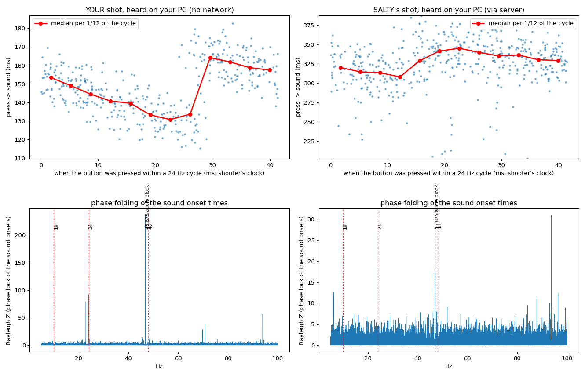

# War Thunder shooting-latency findings (13 and 16 Nov 2026)

## Summary of all runs (read this first)
| What | Ground (tanks, MG) | Air (jets, guns) | How sure |
|---|---|---|---|
| Your shot waits for a game tick | **24 Hz (41.67 ms)**, same at 60 and 120 FPS | **no wait visible** (residual 3.3 ms) | Very strong (ground: 3 sessions, both PCs, 60 and 120 FPS); air: 1 run |
| Server → client packets | **≈ 24.3 Hz** (2 servers) | **≈ 49 Hz** grid (1 server) | Very strong / strong |
| Client → server packets | 24 Hz + 48 Hz harmonic, 45–49 pps | **48.0 Hz**, 59 pps | Very strong |
| Press → own gunshot sound | ≈ 150 ms (148 at 120 FPS, 153 at 60 FPS) | 148 ms | Very strong |
| Press → heard on the other PC | 305–332 ms (median of runs ≈ 315) | 318 ms | Very strong |
| Extra delay for the other player (remote − own) | ≈ 150–180 ms | ≈ 170 ms | Very strong |
| …of which ping (60–70 ms) vs buffering (≈ 2 ticks) | ≈ 65 + ≈ 90–110 ms | not split | Medium (inferred) |
| Taps the other player hears (of taps the shooter heard) | ≈ 94 % | ≈ 78 % (50 % for taps under 50 ms) | Strong (air: 1 run) |
| "10 Hz server" | ruled out on the shot path | ruled out | Strong |
| Game sound engine | mixes in 1024-sample blocks (21.33 ms); artifact, not netcode | same | Very strong |

Anton Yudintsev wrote in 2017 that bullets are stepped at **48 Hz** (`research/raw/anton_reddit_2017.md`). The air packet rate matches that. Ground vehicles in 2026 run their shots on a **24 Hz** step instead. Nothing here measures hit registration directly: the hit-marker test is still open.

---

## Session 2026-11-13 (runs 1–3, ground)

**Data:** `data/20261113/DESKTOP-42SCBR7/` (your PC: audio, inputs, clock, pcap) and Salty's `data/20261113/SALTY/` (inputs only, see problems).

**Runs:**
- **Salty shoots** (09:05–09:10): 510 taps, 467 matched to a gunshot in your PC's audio.
- **You shoot** (09:10–09:15): 463 taps, 403 matched to your own gunshot.

**Clocks:**
- LAN round trip p5 0.31 ms.
- Your PC's clock runs 20.0 ppm away from Salty's, measured and corrected.
- Offset to Salty's clock is −886 ms.

**Regenerate figures:** `python analysis/20261113_findings/make_figures.py`

## 1. Each client fires on a 24 Hz tick (41.67 ms), not 48 Hz
Press time and own-gunshot time were compared, both on the shooter's own PC, so no network is involved.
- **The onsets phase-lock at 24.000 Hz** (Rayleigh Z = 92, n = 403). At 48 Hz Z = 0.2 and at 10 Hz Z = 1.3, i.e. nothing.
- **Delay vs. the press's position in the 24 Hz cycle is a sawtooth.** It falls 1 ms per ms from about 154 to 131 ms, then jumps back up by roughly one period. That is the textbook "shot waits for the next tick" signature (top-left plot).
- **Salty's presses show the same sawtooth** on Salty's own clock (top-right plot), with a different phase. Each PC has its own independent 24 Hz grid.
- **Upstream packets also leave at 24.000 Hz**, with a 48 Hz harmonic: client→server Rayleigh Z = 1494.

This contradicts the 48 Hz fire grid Anton described in 2017, at least for **ground vehicles / tank MG in 2026**.

**Caveat: both PCs ran at a 120 FPS cap, and 120 / 5 = 24.** The grid frequency is 24.0006 ± 0.0001 Hz on your PC's clock. Your PC drives one display at exactly 120.000 Hz and one at 119.982 Hz. On the 120.000 Hz display, "the game acts on every 5th frame" would land on the same number, so this run cannot tell a fixed 24 Hz game tick from a frame-derived one (on the 119.982 Hz display it would be 23.996, which fits clearly worse). Either way, the delay quantum at 120 FPS is 41.67 ms. **Decisive test:** repeat with an FPS cap that 24 doesn't divide evenly, e.g. **60, 90 or 100**. **Resolved by run 3 (60 FPS): the grid stayed at 24.000 Hz, so it is a real game tick.**

## 2. War Thunder mixes sound in 1024-sample blocks (21.33 ms)
- Own-shot onsets lock even harder at **46.875 Hz = 48000/1024** (Z = 236). Its harmonic is 93.75 Hz, and 22.875 Hz is the 46.875 − 24 intermodulation.
- This is the game's audio engine, **not** a network tick. The analyzer now flags it as an artifact.
- After removing the 24 Hz wait, the leftover spread of the own shot has an IQR of 11.6 ms. A uniform 21.33 ms block has an IQR of exactly 10.7 ms.
- **The own-shot chain is fully explained:** a constant ≈112 ms, plus the 24 Hz tick wait, plus the 21.3 ms sound block.

The ≈112 ms constant (input → game → sound out) is large and worth noting. It is present with zero network.

## 3. Server → client updates arrive at ≈24.3 Hz
- Downstream (server→your PC, 130.193.36.201:20026): **41.12 ms dominant spacing**, 15,035 of 25,353 packets. The Rayleigh peak is at 24.318 Hz (Z = 672), with a second peak at 48.6 Hz.
- Average ≈31 packets/s, because extra packets come in between.
- The remote gunshot is **not** played at packet arrival: the time from the last packet to the sound is spread evenly over 2–38 ms. The client schedules the event on its own timeline, which fits the extrapolation and timestamp model.

## 4. Salty's shot heard on your PC, and what it says about a "10 Hz" server
- **Press → heard:** median 329 ms (p5 275, p95 366). The tanks were 50–100 m apart, but the in-game **sound travel delay was turned off**, so this is pure latency. Compared with the own shot (median 148 ms, the same local pipeline), the network + server + observer path adds **≈ 180 ms**. Your in-game ping would show how much of that is wire time and how much is buffering.
- **Spread:** IQR 33.4 ms in total, and 29.3 ms after removing Salty's 24 Hz client wait. The leftover is what the network, server and your client add.
- **A 10 Hz server tick is ruled out for this path.** A wait for a 100 ms tick on its own would produce an IQR of 50 ms, and adding other independent delays only widens it. The measured 29 ms leaves room for a tick no slower than about 17 Hz (≤ 58 ms).
- **What fits:** about 24 Hz server sends (IQR 21 ms), your 21 ms sound block (IQR 11 ms), plus some network jitter or a second ~24 Hz wait.
- The remote onsets show no phase lock at 10, 15, 20, 24, 30 or 48 Hz after the wait is removed.

## Bottom line
| Rate | Value | How sure |
|---|---|---|
| Shooter client fire/input step (ground, MG) at 120 FPS | **24.000 Hz (41.67 ms)** | Very strong (Z 92, sawtooth on both PCs); confirmed FPS-independent by run 3 |
| Client → server packets | 24 Hz + 48 Hz harmonic | Very strong |
| Server → client packets | **≈24.3 Hz (41.1 ms)** | Very strong |
| Game sound mixing | 1024 samples = 21.33 ms | Very strong (an artifact, not netcode) |
| Server tick ≥ ~17 Hz on the shot path; 10 Hz ruled out | | Strong (spread bound) |
| 48 Hz anything in the shot timing | not seen | |

The "10 tick" claim does not hold for shot delivery. The **game's own 24 Hz step plus its 21 ms sound block plus a ~112 ms local pipeline** are what makes shots feel delayed and inconsistent, before the network adds anything.

## Problems in this session and fixes
1. **Salty's audio recorded only 6 s.** The recorder listened to "ASUS VG249 (NVIDIA HDMI)", but the game's sound was going to a different device, probably a headset. Windows loopback delivers nothing for a device that isn't playing anything. Fix: on Salty's PC run `python audio_recorder.py --list` and start with `-AudioDevice "<headset name>"`, or set War Thunder's sound output to the default device. Without this, the direction you → Salty is missing.
2. **Salty tapped too fast:** most gaps were 0.5–0.7 s instead of random 0.6–2 s. Bursts and echoes overlapped the next tap. This was handled with a 200–460 ms search window, but slower random taps give cleaner data.
3. **The analyzer gave a false "24 Hz" verdict on the first pass.** It phase-folded *all* onsets in the recording, including your own shots from the second run. **Fixed:** it now folds only onsets matched to a press.
4. **Each MG tap is a burst of several rounds.** `audio_onsets.py` now keeps only the first round of each burst (`--burst-gap-ms 150`, the default). Its plot now shows the busiest 20 s instead of the silent start.

## Still unknown or next
- Settings confirmed: 120 FPS cap (WT has no 137 option), 50–100 m apart, sound travel delay off.
- ~~The FPS-independence test~~: done in run 3 (60 FPS), 24 Hz confirmed.
- ~~In-game ping~~: 60–70 ms in run 3.
- ~~The you → Salty direction~~: done in run 3.
- ~~Repeat in aircraft~~: done on 16 Nov (see the air section).
- **Still open:** hit-marker timing (server confirmation) vs. the gunshot sound; a second air run with sound travel off; tank main gun.

## Run 2 (09:45–09:55, again 120 FPS): replicates run 1
- **You shoot** (09:48–09:51, 166 matched):
  - press→own sound median 148.1 ms (IQR 21.9)
  - in a blind 15–60 Hz scan, the best "wait" frequency is **24.000 Hz**; removing it leaves an IQR of 12.2 ms (the 21.3 ms sound block)
  - onset lock: Z@24 = 40.5, Z@46.875 = 87.6, Z@48 = 0.4, Z@10 = 0.1
- **Salty shoots** (09:52–09:55, 200 matched):
  - press→heard on your PC median 332 ms (IQR 29.7)
  - the blind scan again picks **24.000 Hz** on Salty's clock (`analysis/20261113_run2_sawtooth/sawtooth.png`)
- **Salty's audio was empty again** (0 buffers, still the "ASUS VG249" HDMI device). The recorder now beeps and prints a warning when its device delivers no sound for 5 s.
- This was still 120 FPS; run 3 (60 FPS) later confirmed the 24 Hz tick is FPS-independent.

## Tool changes after run 2
- `audio_onsets.py`: **piecewise clock fit**. Windows loopback occasionally skips ~8–9 ms of samples to absorb the card-vs-system rate difference. A single straight-line fit gave errors of up to ±5 ms; now it's ±0.5 ms. Run 1 had 2 steps, run 2 had 1.
- `tick_sawtooth.py`: new reusable tool for the sawtooth test with a blind frequency scan.
- `auto_fire.py` / `START_autofire.bat`: optional random-interval auto-fire with a precise press log.

## Run 3 (10:14–10:31, **60 FPS cap on both PCs**, ping 60–70 ms, sound travel off): the 24 Hz tick is real
**Data:** `data/20261113_run3/`
- You fired with `auto_fire.py` (300 presses, 10:16–10:25).
- Salty fired by hand (about 220 presses, 10:26–10:31).
- **Both PCs recorded audio** (Salty on the HyperX headset), so both directions and both own-shot chains were measured.

| Measurement | n | Median | IQR | Best "wait" frequency (blind 15–60 Hz scan) |
|---|---|---|---|---|
| Your own shot (your PC) | 238 | 153 ms | 22.0 → **12.4** after removing the 24 Hz wait | **24.000 Hz** (Z@24 = 46; Z@20/30/60 ≈ 2) |
| Salty's own shot (Salty's PC) | 129 | 152 ms | 23.4 → 15.7 | **24.000 Hz** (Z@24 = 15) |
| You → heard on Salty's PC | 284 | 305 ms | 34.2 | no clear sawtooth |
| Salty → heard on your PC | 165 | 326 ms | 34.3 | no clear sawtooth |

- **At 60 FPS the grid is still exactly 24.000 Hz.** If the game acted on every Nth frame, 60 FPS would give 60, 30, 20, 15 or 12 Hz; none of these show up. So 24 Hz is a **fixed game tick, independent of frame rate**. This settles the open question from runs 1–2. It is now measured on both PCs, at 120 and 60 FPS, by hand and by auto-fire.
- **Frame rate costs a little:** own shot median 153 ms at 60 FPS vs. 148 ms at 120 FPS (+5 ms, i.e. a few frames of 16.7 instead of 8.3 ms in the pipeline).
- **Network leg:** remote minus own is ≈ 150–175 ms. With an RTT of 60–70 ms (shooter→server plus server→observer ≈ one RTT), about **90–110 ms** remains. That is roughly **2–2.5 ticks of 41.7 ms**, consistent with the observer playing remote events about 2 ticks behind (interpolation/jitter buffer). This is an inference from medians, not a direct measurement.
- **Server→client packets again ≈ 24.3 Hz** (24.29 Hz, Z = 316), on a different server (185.253.20.248:20035). Client→server about 45 packets/s. Press → next upstream packet: p50 12.8 ms, p95 33.6 ms.
- Remote spread (IQR about 34 ms) didn't show a clean sawtooth from the shooter's tick this time. The network and observer side add enough randomness to hide it. That doesn't change the conclusion, which rests on the own-shot chain.

## Recording problems in run 3 and fixes
- **Your recorders wrote to Salty's network share.** Slow network writes made the audio recorder miss more than 100 small chunks (about 8 ms each, 2 s in total). **Run the recorders from the local copy** (`Desktop\Warthunder Netcode experiment`) and copy the data afterwards.
- **Salty's HyperX virtual-surround driver sends nothing while the sound is quiet:** 235 gaps, 19.6 s in total.
- **Fix:** `audio_onsets.py` now maps sample → time with a per-buffer local lower envelope that splits at every gap and step. On a harsh simulation with 150 drop-outs and 200 gaps, the mapping error was median 0.3 ms with 99% of samples within 1.8 ms.
- **Fix:** War Thunder's 1024-sample sound block (46.875 Hz) is now always flagged as an artifact. Before this, it faked a "15.6 Hz" verdict (3 × 21.33 ms) on Salty's gappy recording.

## Updated bottom line
| Rate | Value | How sure |
|---|---|---|
| **Client fire/simulation tick** (ground, MG) | **24 Hz (41.67 ms), independent of FPS** | Very strong: 3 sessions, both PCs, 60 and 120 FPS; blind scans all pick 24.000 Hz |
| Server → client packets | ≈ 24.3 Hz (41.1 ms) | Very strong, two different servers |
| Client → server packets | 24 Hz + 48 Hz harmonic (≈ 45–49 pps) | Very strong |
| Remote events played behind arrival | ≈ 2 ticks (90–110 ms beyond the RTT) | Medium (inferred from medians plus ping) |
| Local press → own sound | ≈ 150 ms (112 ms constant + tick wait + 21 ms sound block) | Very strong |
| 10 Hz anything | not seen | Ruled out on the shot path |

## Air run (16 Nov 2026, 14:53–15:04): custom battle in planes, Salty shooting, your PC listening
Data: `data/20261116_air/`. Scripts and figure: `analysis/20261116_air/`. Salty fired 268 short taps (hold median 65 ms, gaps 0.7–1.9 s).

**1. In planes, the own gunshot is not held to a 24 Hz or 48 Hz step.**
- Press → own sound on Salty's PC: median 148 ms, IQR 13.3 ms. On the ground it was IQR 22 ms.
- Almost all of that spread is War Thunder's 1024-sample sound block. Fitted at 46.870 Hz, which matches Salty's sound card running at 47,995 Hz. After removing it, the leftover IQR is only **3.3 ms**.
- A wait for a 24 Hz step would leave at least 20.8 ms of IQR, and a 48 Hz step at least 10.4 ms. Neither is there. Whatever step the plane's gun waits for is shorter than about 7 ms (frame-level), or the sound is played straight from the input.

**2. Air network rates are about double the ground rates.**

| Direction | Air | Ground |
|---|---|---|
| Server → client | 31 packets/s, dominant Rayleigh peak **49.1 Hz** (most common gap 20 ms) | 24.3 Hz |
| Client → server | 59 packets/s, **48.0 Hz** (Z = 1980) | 24 + 48 Hz, 45 pps |

The air server was 178.154.233.44:20028. This fits Anton's 2017 statement that bullets are stepped at 48 Hz. His post also says shots are fired on that grid; the own-shot *sound* shows no such wait, so in planes the sound is probably played straight from the input while the bullet itself may still start on the 48 Hz grid.

**3. About 1 in 5 taps is never played on the other PC.**
- Salty heard their own shot on 249 of 268 taps. Your PC heard 195 (194 of the 249). All rates below use the 249 taps Salty heard as the base, the same base as the ground figure. Counting all 268 taps instead gives 73 % overall and 49 / 72 / 85 % by hold time.
- 55 taps were heard on Salty's PC and not on yours. In the raw audio of those taps, your PC plays **no gunshot at all** in the 0–800 ms after the press (figure `missing_taps_audio.png`), so this is not a detection miss.
- **Short taps go missing most:**

  | Hold | Taps heard on the other PC | Taps |
  |---|---|---|
  | under 50 ms | 50 % | 42 |
  | 50–70 ms | 78 % | 120 |
  | 70 ms and longer | 91 % | 87 |

- **It's not "every second round".** A miss is slightly *more* likely right after another miss (25 % vs 21 %), the opposite of an alternating pattern. The press's position within the cycle makes no difference.
- **Ground for comparison (run 3):** 94 % of Salty's taps that Salty heard were also heard on your PC, with longer holds (median 79 ms).
- **Likely explanation:** very short trigger pulls (one or two rounds) are often not passed on to, or not played by, the other players' clients. Longer bursts are.
- **Packet check:** I compared downstream packet sizes after heard and missing taps. No difference showed, because a single shot is too small next to the rest of the traffic, so this test can't tell whether the server sent the missing shots.

**4. Remote delay in air:** median 318 ms, IQR 65 ms (ground 34 ms), with no tick structure. The extra spread may come from changing distance if sound travel delay was on in this run. That setting wasn't recorded.

### Bottom line for air
| | Air | Ground |
|---|---|---|
| Own shot waits for a step | none ≥ 48 Hz visible (residual 3.3 ms) | 24 Hz |
| Server → client | ≈ 49 Hz grid | ≈ 24.3 Hz |
| Client → server | 48 Hz | 24/48 Hz |
| Taps heard by the other player (of taps the shooter heard) | ≈ 78 % (50 % for taps under 50 ms) | ≈ 94 % |
