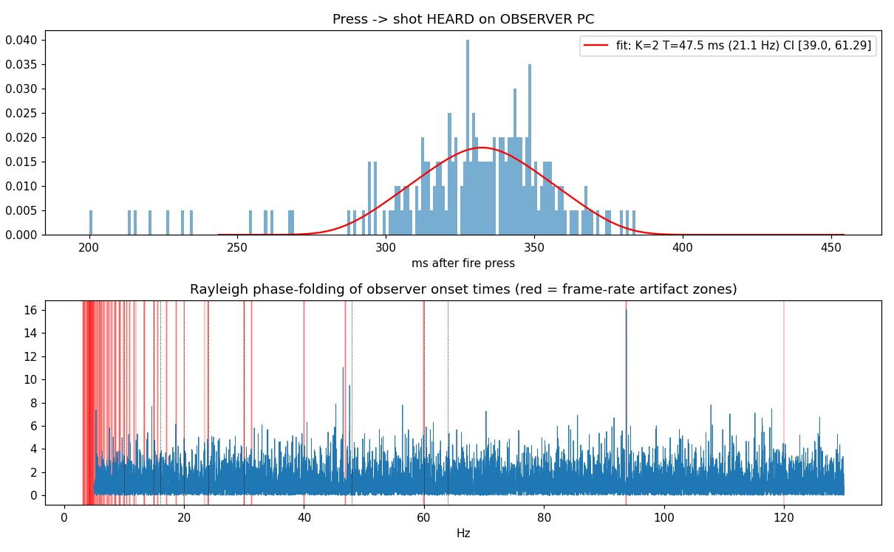

# Shooting latency report

- Presses: 218 total, 217 isolated, 200 matched on the observer video
- Observer timing source: {'mode': 'audio', 'onsets': 960, 'mixer_block_ms': 10.6667}
- Clock (shooter vs Salty): is reference; (observer vs Salty): {'windows': 82, 'offset_ms_median': -939.8133, 'offset_ms_range': 7.7275, 'rtt_ms_p5': 0.3388}

## VERDICT: tick period 47.5 ms ≈ 21.05 Hz
_FIT-ONLY: no strong phase-locked peak (tick may not be phase-stable, or too few presses)_

## Press → visible on observer
Delay percentiles (ms): {'p5': 266.99, 'p25': 317.08, 'p50': 332.28, 'p75': 346.76, 'p95': 366.41}
(absolute delays are relative to the flash overlay's own display latency; the tick period is unaffected)

**Spread fit: T = 47.5 ms ≈ 21.05 Hz (95 % CI [39.0, 61.29] ms), K = 2 uniform wait(s), n = 200**
- one-wait model: {'c_ms': 292.84, 'T_ms': 62.5, 'sigma_ms': 8.0, 'K': 1, 'LL': -966.43}
- two-wait model: {'c_ms': 275.64, 'T_ms': 47.5, 'sigma_ms': 8.0, 'K': 2, 'LL': -963.26}
- Interpretation: T is the period of the tick the shot has to wait for. K = 2 means two independent waits of the same period (e.g. client fire grid + server tick).

## Phase-folding peaks (observer onsets)
- 93.75 Hz (Z=16.0)  ⚠ frame-rate artifact zone (fps/k)
- 46.52 Hz (Z=11.0)
- 47.61 Hz (Z=9.5)
- 45.32 Hz (Z=7.9)
- 107.84 Hz (Z=7.8)

## packets_observer
```
{
  "flow": "130.193.36.201:20026",
  "up_pps": 49.59,
  "down_pps": 32.05,
  "last_downstream_to_onset_ms": {
    "p5": 2.19,
    "p50": 18.43,
    "p95": 37.88
  },
  "downstream_rayleigh_peaks_hz": [
    [
      24.31,
      358.2
    ],
    [
      98.87,
      163.5
    ],
    [
      74.54,
      141.7
    ],
    [
      48.47,
      124.5
    ],
    [
      123.19,
      74.8
    ]
  ]
}
```


