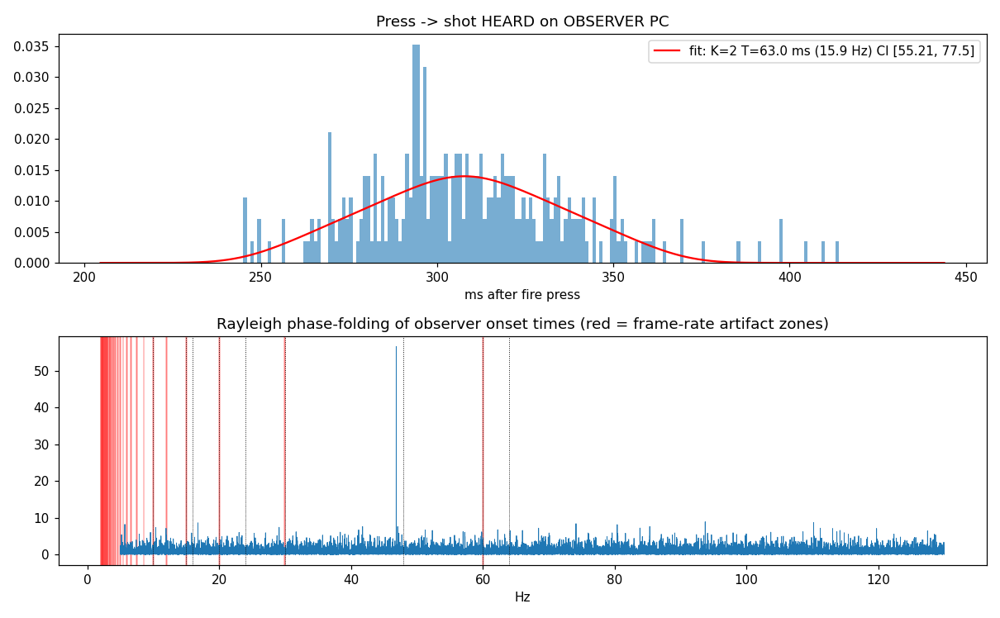

# Shooting latency report

- Presses: 300 total, 300 isolated, 284 matched on the observer video
- Observer timing source: {'mode': 'audio', 'onsets': 1577, 'mixer_block_ms': 0.0}
- Clock (shooter vs Salty): {'windows': 202, 'offset_ms_median': -975.3101, 'offset_ms_range': 18.942, 'rtt_ms_p5': 0.2889}; (observer vs Salty): is reference

## VERDICT: tick period 63.0 ms ≈ 15.87 Hz
_FIT-ONLY: no strong phase-locked peak (tick may not be phase-stable, or too few presses)_

## Press → visible on observer
Delay percentiles (ms): {'p5': 266.17, 'p25': 291.49, 'p50': 305.3, 'p75': 325.65, 'p95': 359.34}
(absolute delays are relative to the flash overlay's own display latency; the tick period is unaffected)

**Spread fit: T = 63.0 ms ≈ 15.87 Hz (95 % CI [55.21, 77.5] ms), K = 2 uniform wait(s), n = 284**
- one-wait model: {'c_ms': 254.64, 'T_ms': 89.5, 'sigma_ms': 8.0, 'K': 1, 'LL': -1388.27}
- two-wait model: {'c_ms': 236.54, 'T_ms': 63.0, 'sigma_ms': 8.0, 'K': 2, 'LL': -1375.03}
- Interpretation: T is the period of the tick the shot has to wait for. K = 2 means two independent waits of the same period (e.g. client fire grid + server tick).

## Phase-folding peaks (observer onsets)
- 46.87 Hz (Z=56.7)  ⚠ frame-rate artifact zone (fps/k)
- 93.74 Hz (Z=8.9)  ⚠ frame-rate artifact zone (fps/k)
- 110.19 Hz (Z=8.7)
- 16.79 Hz (Z=8.7)
- 74.14 Hz (Z=8.4)

## packets_shooter
```
{
  "flow": "185.253.20.248:20035",
  "up_pps": 45.25,
  "down_pps": 31.18,
  "press_to_next_upstream_ms": {
    "p5": 1.7,
    "p50": 12.76,
    "p95": 33.57
  },
  "downstream_rayleigh_peaks_hz": [
    [
      24.29,
      315.8
    ],
    [
      98.5,
      184.9
    ],
    [
      74.33,
      138.1
    ],
    [
      122.89,
      101.9
    ],
    [
      50.04,
      95.5
    ]
  ]
}
```


