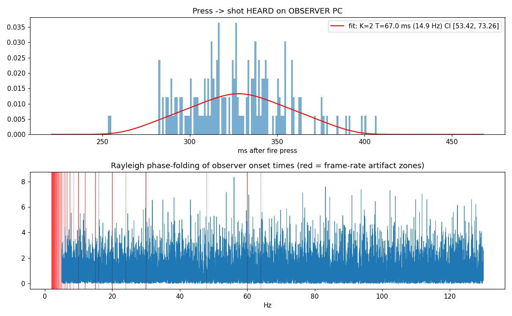

# Shooting latency report

- Presses: 241 total, 218 isolated, 165 matched on the observer video
- Observer timing source: {'mode': 'audio', 'onsets': 1606, 'mixer_block_ms': 0.0}
- Clock (shooter vs Salty): is reference; (observer vs Salty): {'windows': 202, 'offset_ms_median': -975.3101, 'offset_ms_range': 18.942, 'rtt_ms_p5': 0.2889}

## VERDICT: tick period 67.0 ms ≈ 14.93 Hz
_FIT-ONLY: no strong phase-locked peak (tick may not be phase-stable, or too few presses)_

## Press → visible on observer
Delay percentiles (ms): {'p5': 286.39, 'p25': 308.77, 'p50': 325.98, 'p75': 343.04, 'p95': 375.56}
(absolute delays are relative to the flash overlay's own display latency; the tick period is unaffected)

**Spread fit: T = 67.0 ms ≈ 14.93 Hz (95 % CI [53.42, 73.26] ms), K = 2 uniform wait(s), n = 165**
- one-wait model: {'c_ms': 277.07, 'T_ms': 89.5, 'sigma_ms': 8.0, 'K': 1, 'LL': -797.79}
- two-wait model: {'c_ms': 252.77, 'T_ms': 67.0, 'sigma_ms': 8.0, 'K': 2, 'LL': -786.59}
- Interpretation: T is the period of the tick the shot has to wait for. K = 2 means two independent waits of the same period (e.g. client fire grid + server tick).

## Phase-folding peaks (observer onsets)
- 56.1 Hz (Z=8.3)
- 83.18 Hz (Z=7.6)
- 93.75 Hz (Z=7.4)  ⚠ frame-rate artifact zone (fps/k)
- 102.32 Hz (Z=7.3)
- 53.81 Hz (Z=7.2)

## packets_observer
```
{
  "flow": "185.253.20.248:20035",
  "up_pps": 45.25,
  "down_pps": 31.18,
  "last_downstream_to_onset_ms": {
    "p5": 1.83,
    "p50": 18.03,
    "p95": 38.61
  },
  "downstream_rayleigh_peaks_hz": [
    [
      24.29,
      315.8
    ],
    [
      98.5,
      184.9
    ],
    [
      74.33,
      138.1
    ],
    [
      122.89,
      101.9
    ],
    [
      50.04,
      95.5
    ]
  ]
}
```


