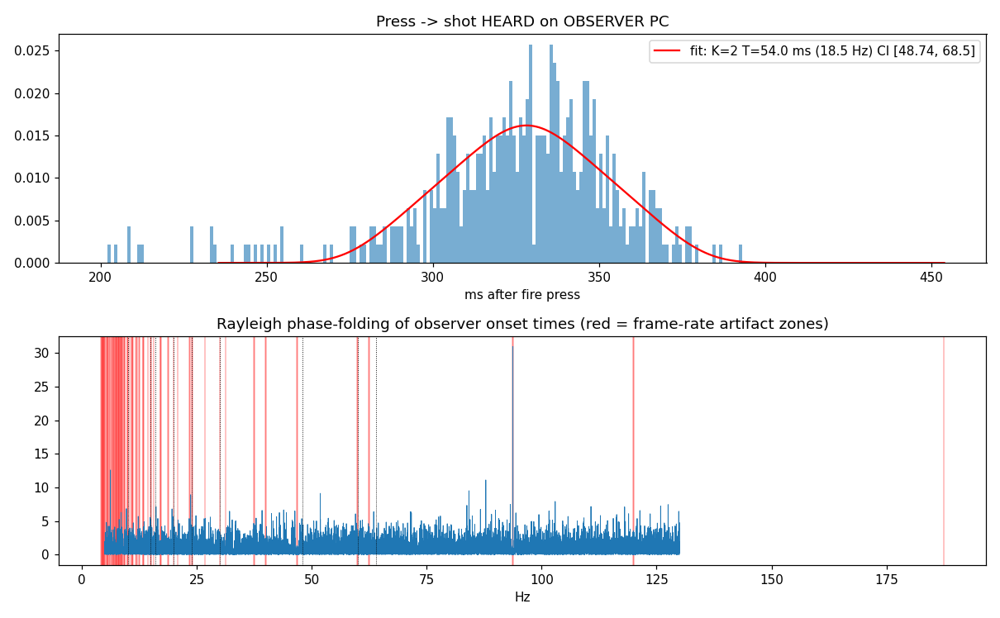

# Shooting latency report

- Presses: 510 total, 507 isolated, 467 matched on the observer video
- Observer timing source: {'mode': 'audio', 'onsets': 1892, 'mixer_block_ms': 5.3333}
- Clock (shooter vs Salty): is reference; (observer vs Salty): {'windows': 208, 'offset_ms_median': -886.4583, 'offset_ms_range': 20.5759, 'rtt_ms_p5': 0.3134}

## VERDICT: tick period 54.0 ms ≈ 18.52 Hz
_FIT-ONLY: no strong phase-locked peak (tick may not be phase-stable, or too few presses)_

## Press → visible on observer
Delay percentiles (ms): {'p5': 275.08, 'p25': 311.17, 'p50': 328.79, 'p75': 344.61, 'p95': 366.04}
(absolute delays are relative to the flash overlay's own display latency; the tick period is unaffected)

**Spread fit: T = 54.0 ms ≈ 18.52 Hz (95 % CI [48.74, 68.5] ms), K = 2 uniform wait(s), n = 467**
- one-wait model: {'c_ms': 284.15, 'T_ms': 75.0, 'sigma_ms': 8.0, 'K': 1, 'LL': -2279.02}
- two-wait model: {'c_ms': 267.55, 'T_ms': 54.0, 'sigma_ms': 8.0, 'K': 2, 'LL': -2261.32}
- Interpretation: T is the period of the tick the shot has to wait for. K = 2 means two independent waits of the same period (e.g. client fire grid + server tick).

## Phase-folding peaks (observer onsets)
- 93.75 Hz (Z=31.0)  ⚠ frame-rate artifact zone (fps/k)
- 6.23 Hz (Z=12.6)
- 87.86 Hz (Z=11.1)
- 84.2 Hz (Z=9.5)
- 51.86 Hz (Z=9.1)

## packets_observer
```
{
  "flow": "130.193.36.201:20026",
  "up_pps": 49.09,
  "down_pps": 30.99,
  "last_downstream_to_onset_ms": {
    "p5": 1.95,
    "p50": 19.48,
    "p95": 37.9
  },
  "downstream_rayleigh_peaks_hz": [
    [
      24.33,
      599.5
    ],
    [
      98.86,
      182.0
    ],
    [
      74.53,
      161.1
    ],
    [
      48.58,
      125.0
    ],
    [
      99.58,
      95.7
    ]
  ]
}
```


